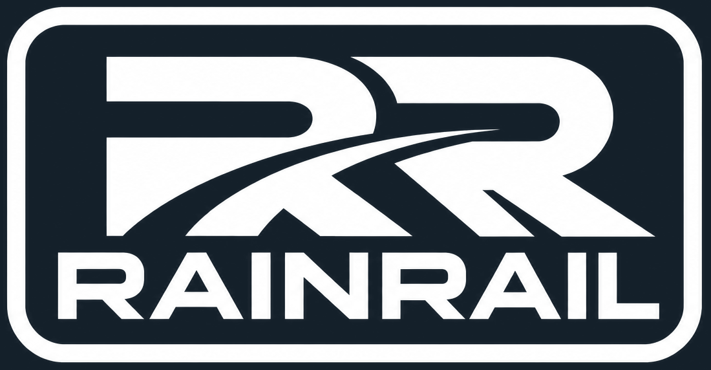
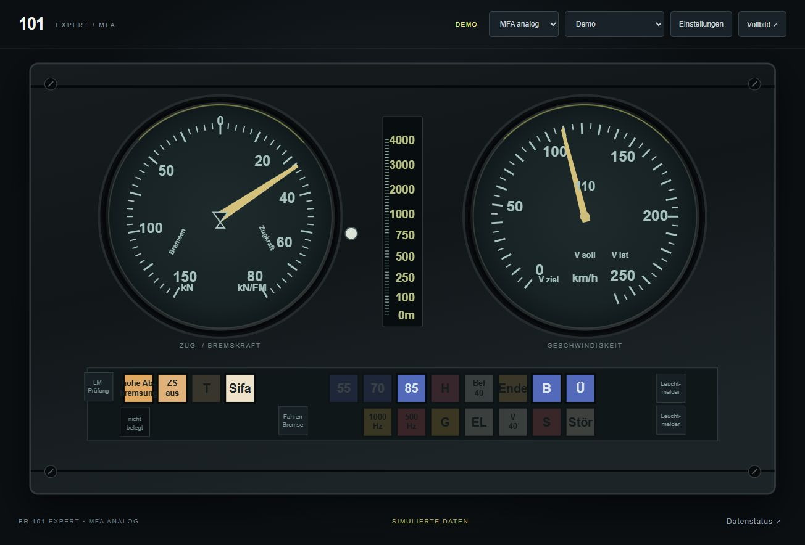
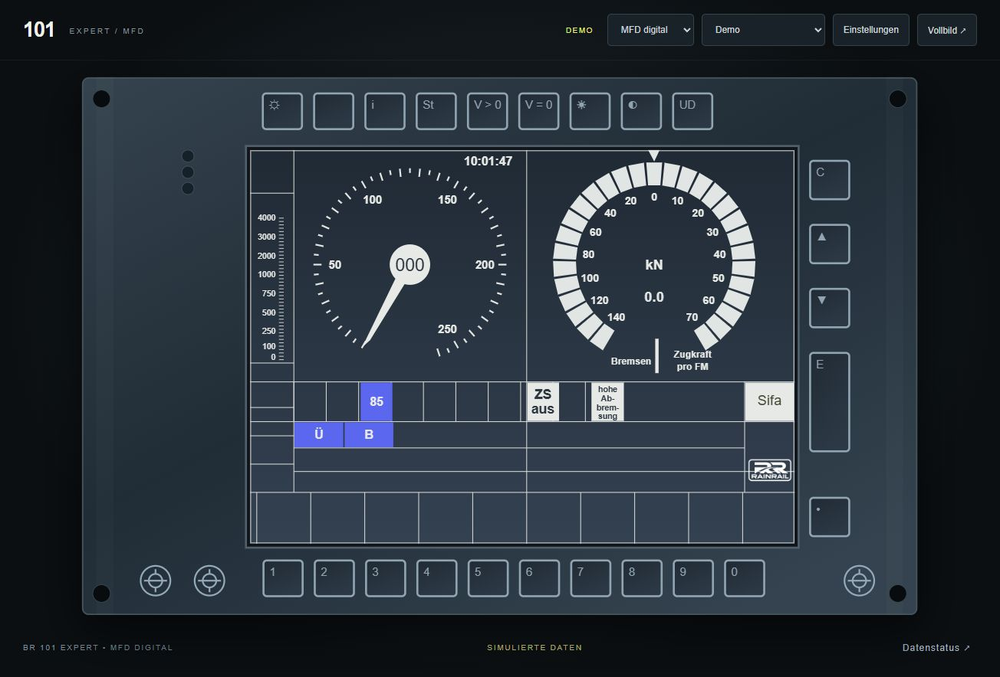
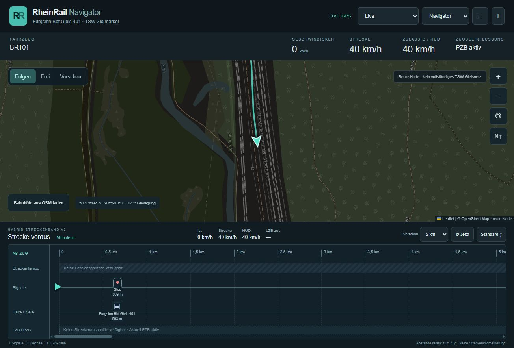

# RheinRail TrainOS

<p align="center"></p>

Lokales Companion-Dashboard für **Train Sim World 7**: digitale und analoge BR-101-Expert-Anzeigen, eine GPS-Karte und ein grafisches Hybrid-Streckenband. Ein lokaler HTTP-Adapter liest die verfügbaren Spieldaten und stellt die Oberfläche für PC und Tablets bereit.

Unabhängiges Fanprojekt. Keine offizielle Anwendung von Dovetail Games, Deutsche Bahn oder dem Fahrzeughersteller. **Experimentell:** Die Entwicklung wurde mit der TSW-7-API, Build 902, und der BR 101 Expert geprüft. Ein vollständiger Ersatz der Spielanzeigen oder eines echten Buchfahrplans ist nicht implementiert.

## Funktionen

| Bereich | Implementierter Umfang |
| --- | --- |
| MFD digital | BR-101-inspirierte Hauptanzeige mit Tastenrahmen, Geschwindigkeit, Zug-/elektrischer Bremskraft, ausgewählten PZB-/LZB- und Fahrzeugmeldern |
| MFA analog | Zwei Rundinstrumente, mittlere LZB-Entfernungsskala und Leuchtmeldertafel |
| RheinRail Navigator | Reale OpenStreetMap-Hintergrundkarte, TSW-GPS-Position, gemessene Bewegungsausrichtung und GPS-Spur |
| Kartenbedienung | Verschieben, Mausrad-/Pinch-Zoom, Zoomtasten, Folgen, freier Modus, Vorschau und Zentrieren; Norden bleibt oben |
| Hybrid-Streckenband V2 | Maßstäbliche relative Signalabstände, verfügbare Geschwindigkeitswechsel und TSW-Zielmarker; 2/5/10/20-km-Zoom, Scrollen, pausierbare Nachführung und drei Größen |
| Mehrere Geräte | Gemeinsamer lokaler Adapter mit zwischengespeicherten Datenströmen und getrennten Browsereinstellungen |
| Demo | Einstellbare MFD-/MFA-Simulation sowie deutlich gekennzeichnete anonymisierte Navigator-Aufnahme |
| Sicherheit | Keine Spiel-Steuerbefehle; der TSW-Schlüssel bleibt im Adapter auf dem PC |

Tasten am MFD-Rahmen sind optisch. Displaymenüs, Zugdateneingaben und Fahrzeugbedienung sind nicht implementiert. Die Anwendung verwendet nachgezeichnete Vektorgrafiken, keine extrahierten Spieltexturen.

## Ansichten

Die folgenden Bilder zeigen die selbst entwickelte Weboberfläche, keine Originaltexturen. Das vom Projektinhaber bereitgestellte RAINRAIL-Logo ersetzt das frühere DB-Zeichen. Hinweise zu Marken, Nachbildungen und Logo-Herkunft stehen in [RIGHTS.md](RIGHTS.md).

### MFA analog



### MFD digital



### Navigator und Streckenband



Kartengrundlage im Navigator-Bild: © [OpenStreetMap-Mitwirkende](https://www.openstreetmap.org/copyright), ODbL. Die Karte zeigt die reale Welt und kann von TSW abweichen.

## Voraussetzungen

- Windows-PC mit Train Sim World 7 und aktivierter HTTP API für Live-Daten.
- Die geprüften Instrumentenprofile benötigen die BR 101 Expert.
- [Node.js](https://nodejs.org/) ab Version 22.
- Moderner Browser. Für Kartenkacheln und optionale externe Bahnhofsdaten wird Internet benötigt.
- Tablets im selben lokalen Netzwerk wie der Spiel-PC. Es werden weder Router-Portfreigabe noch Cloud-Hosting benötigt.

Es sind keine zusätzlichen npm-Pakete zu installieren. Der Server verwendet Node-Standardmodule; Leaflet ist einschließlich Lizenz lokal mitgeliefert.

## Installation und Start unter Windows

1. Dieses Repository herunterladen oder klonen und in einen eigenen Ordner entpacken.
2. Node.js installieren, falls es noch nicht vorhanden ist.
3. Für die Nutzung nur auf dem PC **`Start.cmd`** doppelklicken.
4. Das Startfenster geöffnet lassen und [http://localhost:8787](http://localhost:8787) aufrufen.

Alternativ im Projektordner:

```powershell
npm start
```

Ansichten direkt öffnen:

| Ansicht | Adresse auf dem Spiel-PC |
| --- | --- |
| MFD | `http://localhost:8787/?display=mfd` |
| MFA | `http://localhost:8787/?display=mfa` |
| Navigator | `http://localhost:8787/?display=navi` |

`/?display=navigator` wird ebenfalls unterstützt. Die Anzeigeauswahl oben wechselt zwischen den Bereichen. Beenden: im Startfenster **Strg+C**. Nur eine Serverinstanz pro Port starten.

## TSW HTTP API einrichten

Die bisher geprüfte Einrichtung verwendet die Windows-Steam-Version:

1. In den Steam-Eigenschaften von TSW 7 die Startoption **`-HTTPAPI`** ergänzen.
2. TSW neu starten und ein Fahrzeug laden.
3. Die vom Spiel erzeugte Datei `CommAPIKey.txt` muss unter `Documents/My Games/TrainSimWorld7/Saved/Config/` im Benutzerprofil liegen.
4. In der Weboberfläche **„TSW Live · nur lesen“** beziehungsweise **„Live“** wählen.

Der Adapter liest den Schlüssel direkt aus dieser Datei und sendet ihn ausschließlich im `DTGCommKey`-Header an die Spiel-API auf `127.0.0.1:31270`. **Die Schlüsseldatei niemals ins Repository kopieren, in Screenshots zeigen oder weitergeben.** Ein abweichender Dateipfad kann lokal über `TSW_KEY_FILE` gesetzt werden; kein tatsächlicher Schlüssel gehört in eine Konfigurationsdatei des Projekts.

Die Aktivierung in anderen Launchern ist hier nicht verifiziert. API- und Spielupdates können Feldnamen oder Fahrzeugverhalten ändern.

## Tablets und lokales Netzwerk

Für iPad, Galaxy Tab oder einen zweiten Computer **`Start-Tablet.cmd`** verwenden. Alternativ:

```powershell
node server.mjs --lan
```

Der Server zeigt die Netzwerkadressen des PCs im Startfenster an. Im Tablet-Browser die angezeigte Adresse verwenden und die gewünschte Ansicht anhängen, beispielsweise `/?display=navi`. Auf dem Tablet bedeutet `localhost` das Tablet selbst – dort muss die Adresse des Spiel-PCs stehen.

Windows muss den Zugriff gegebenenfalls im privaten Netzwerk erlauben. Es wird keine Firewall-Regel automatisch eingerichtet. Im LAN-Modus ist die Anzeige ohne Anmeldung für erreichbare Geräte verfügbar; nur in einem vertrauenswürdigen lokalen Netz verwenden. Keine Router-Portfreigabe einrichten.

Beispielbetrieb: MFD/MFA auf einem Galaxy Tab, Navigator auf einem iPad. Jedes Gerät speichert seine Ansichts- und Navigator-Einstellungen selbst. Der Server fragt das Spiel nicht für jeden Navigator-Browser separat ab. Physischer iPad-/Tab-S8-Parallelbetrieb und echte Touchgesten sind noch nicht vollständig getestet.

## Unterstützte Fahrzeuge und Daten

Für MFD/MFA sind diese beiden tatsächlich geprüften Expert-Kennungen freigeschaltet:

- `RVM_CRG_DB_BR101_C`
- `RVM_CRG_DB_BR101_ETCS_C`

Andere Varianten erhalten keine geratenen Instrumentenzuordnungen. Der Navigator ist allgemeiner aufgebaut und kann mit anderen Fahrzeugen funktionieren, sofern deren geprüfte Standarddaten verfügbar sind; eine allgemeine Kompatibilitätsgarantie besteht nicht.

Geschwindigkeit, Kraft und Fahrzeugmelder stammen aus den verfügbaren Fahrzeug-Endpunkten. Die Kraftquelle ist asymmetrisch: **positive Kraft pro Fahrmotor, negative elektrische Bremskraft gesamt**. Druckluftbremsdruck wird dadurch nicht dargestellt. Sifa kann auch bei ausgeschalteter Sifa leuchten. Nicht jeder mögliche PZB-/LZB-Störzustand wurde im Spiel ausgelöst und verglichen.

Im Navigator sind **Streckengeschwindigkeit, HUD-Vorgabe und LZB-zulässige Geschwindigkeit getrennte Werte**. Aus einem aktuellen Fahrzeugstatus werden keine LZB-/PZB-Streckenabschnitte abgeleitet. Daten älter als fünf Sekunden werden ausgeblendet; ein Verbindungsverlust schaltet nicht automatisch zur Demo.

## Navigator und Streckenband

Die Karte ist eine reale Hintergrundkarte. Die türkise Spur enthält nur bereits gemessene GPS-Punkte des Zuges, kein vollständiges TSW-Gleisnetz. Die Bewegungsrichtung wird erst nach einer messbaren GPS-Bewegung bekannt. Streckenname und Kilometrierung werden nicht aus dem Ort geschätzt.

Das Streckenband zeigt echte relative Entfernungen. Manuelles Ziehen, Rad-/Trackpad-Scrollen und Touch-Verschieben pausieren die automatische Nachführung. **„Jetzt“** setzt den Ausschnitt auf 0 m zurück. Zoom und Größe werden je Gerät gespeichert.

Farbige Geschwindigkeitsintervalle entstehen ausschließlich zwischen gemeldeten Streckengrenzen. Hinter der letzten bekannten Grenze bleibt der Bereich unbekannt. Temporäre Beschränkungen werden nicht als allgemeines Streckentempo fortgeschrieben. Ohne Abschnittsdaten bleibt die LZB-/PZB-Zeile als unbekannt gekennzeichnet.

Antippbare Ereignisse öffnen eine Infokarte. Nur Objekte mit einer bestätigten GPS-Position dürfen die Karte zentrieren. Signalpositionen aus lokalen Spielkoordinaten werden nicht in geratene GPS-Punkte umgewandelt.

Optionale OSM-Bahnhöfe sind reale Objekte, keine bestätigten TSW-Zuordnungen. Öffentliche Abfragedienste können ausfallen. Für Fulda liegt eine einzelne, ausdrücklich gekennzeichnete OSM-Referenz bei; es ist kein vollständiges Bahnhofsverzeichnis enthalten.

## Demo-Modus

- **MFD/MFA:** „Demo“ auswählen und unter Einstellungen Geschwindigkeit, Kraft und Sifa-Anzeige verändern. Die Werte sind simuliert.
- **Navigator:** „Aufnahme / Demo“ zeigt eine gespeicherte, anonymisierte API-Messung. Das ist keine laufende Fahrt und keine Live-Position. Die Karte benötigt weiterhin Internet.

Die enthaltenen Testdaten sind auf erforderliche Messfelder reduziert. Originaldiagnosen, Benutzernamen, Sitzungskennungen, Schlüssel und lokale Pfade gehören nicht zum Projektpaket.

## Projektstruktur

```text
dist/
  profiles/             MFD- und MFA-Vektordarstellungen
  app.js, sources.js    Instrumentenoberfläche und Datenquellen
  navi.*                Eigenständige Navigator-Seite
  route-strip.*         Grafisches Streckenband V2
  strip-model.js        Maßstab und sichere Geschwindigkeitsintervalle
  vendor/               Leaflet 1.9.4 mit BSD-2-Clause-Lizenz
data/                   Öffentliche OSM-Referenzdaten
test/fixtures/          Minimierte, bereinigte Testwerte
docs/screenshots/       Bilder der selbst entwickelten Weboberfläche
telemetry.mjs           Fahrzeugbezogene API-Zuordnungen
navigation.mjs          GPS, Ereignisse und optionale OSM-Abfrage
server.mjs              Lokaler Webserver und gemeinsamer Adapter-Cache
*.test.mjs              Node-Tests
Start*.cmd              Windows-Startdateien
```

Die verwendeten API-Felder und Datenregeln sind in [docs/API.md](docs/API.md) dokumentiert.

## Tests

```powershell
npm test
```

Die Tests laufen ohne TSW, echte Schlüsseldatei oder zusätzliche Pakete. Sie prüfen unter anderem Einheiten, ungültige und veraltete Werte, Fahrzeugwechsel, beide Expert-Kennungen, die Instrumentenanzeige, Blinklogik, GPS-Kursberechnung und die maßstäbliche Platzierung sowie begrenzte Geschwindigkeitsintervalle im Streckenband.

Die getestete Ausgangsfassung enthält **24 bestandene Tests**. Browserprüfungen ersetzen keinen vollständigen Fahr-, Geräte- oder Langzeittest.

## Bekannte Probleme und geplante Erweiterungen

- Kein vollständiges TSW-Gleisnetz und keine gesicherte Streckenkilometrierung.
- Keine bestätigten geografischen Signalpositionen, vollständigen Bahnhofsdaten oder LZB-/PZB-Abschnittsgrenzen.
- Einzelne Fahrzeugmelder und ungewöhnliche PZB-/LZB-Zustände müssen weiter verglichen werden; nicht belegte Melder bleiben dunkel.
- Abweichungen der realen OSM-Karte vom Spiel sind möglich. Externe Bahnhofsdienste sind experimentell und nicht immer erreichbar.
- Kartenrotation, importierbare Streckenprofile und ICE-Displays sind noch nicht implementiert.
- Geplant sind weitere bestätigte Fahrzeugprofile, Streckenprofile und zusätzliche Geräte-/Langzeittests. Es gibt dafür keine zugesagte Unterstützung oder Terminplanung.

## Lizenzstatus

Für den projektspezifischen Code ist zunächst **keine allgemeine Open-Source-Lizenz erteilt**. Die Rechte an Marken, Nachbildungen und Referenzmaterial sind separat zu prüfen; eine fehlende Projektlizenz klärt diese Rechte nicht. Als spätere Lizenz für die eigenen, geklärten Codebestandteile wird MIT vorgeschlagen.

Leaflet behält seine BSD-2-Clause-Lizenz, OSM-Inhalte ihre jeweiligen Bedingungen. Siehe [THIRD_PARTY_NOTICES.md](THIRD_PARTY_NOTICES.md) und [RIGHTS.md](RIGHTS.md). Die Sichtbarkeit auf GitHub allein macht das Projekt nicht zu frei lizenzierter Open-Source-Software.
