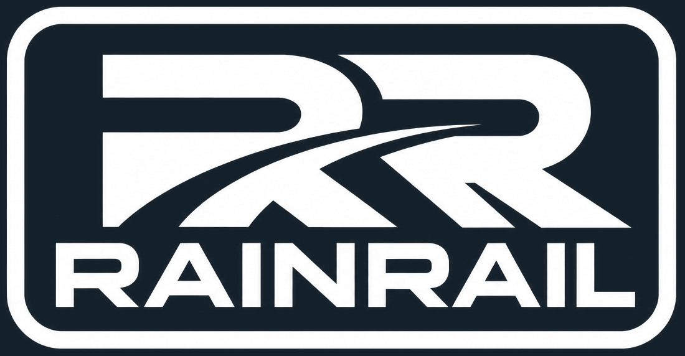
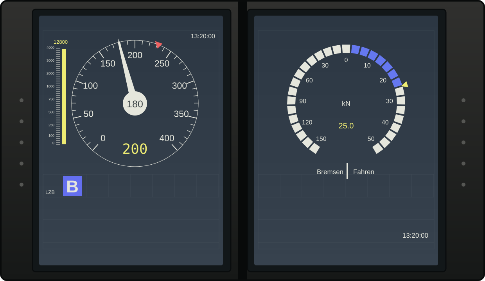
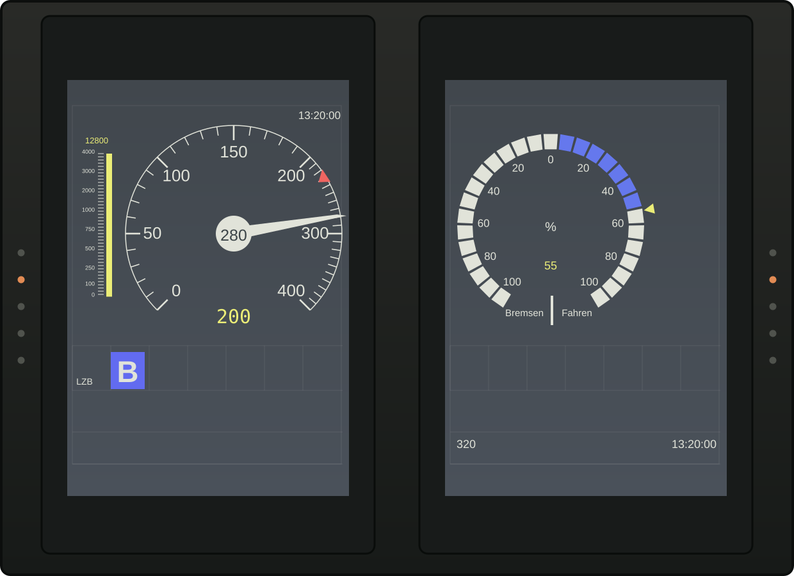
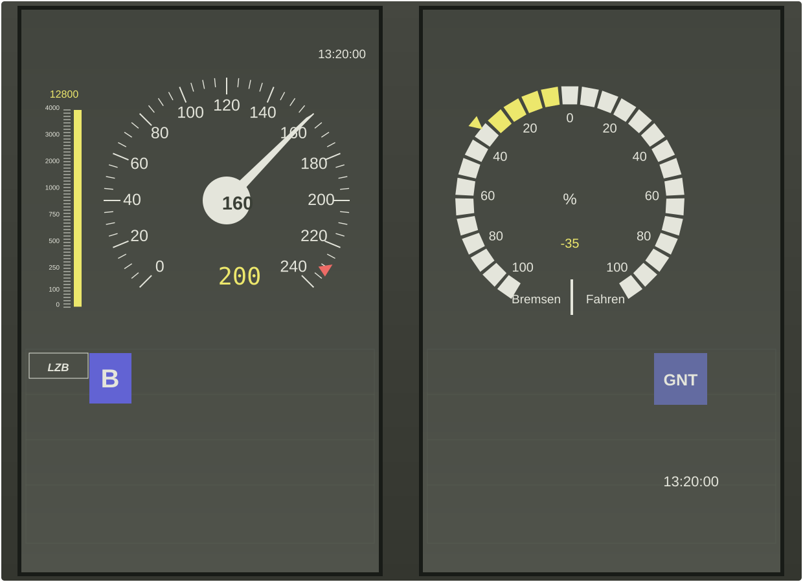
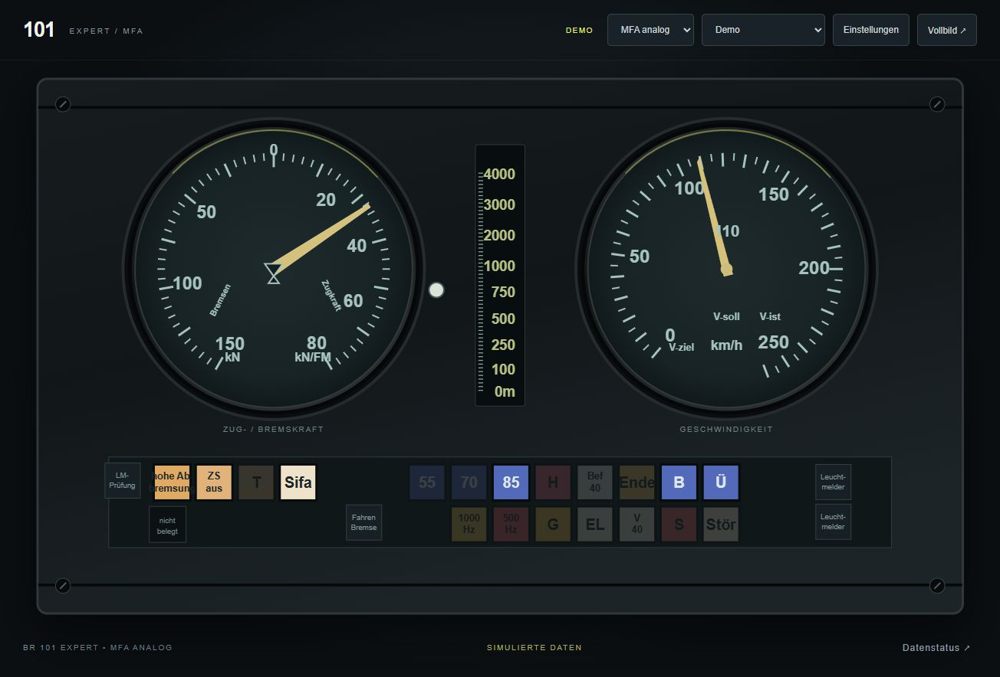
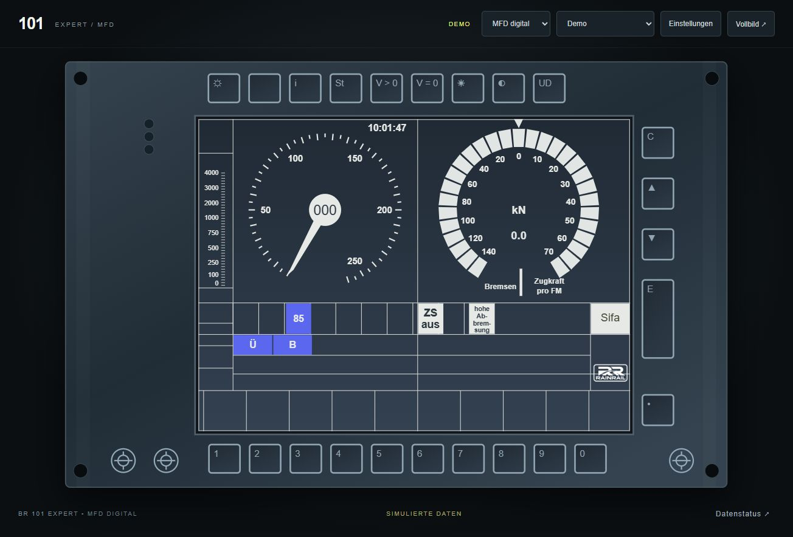
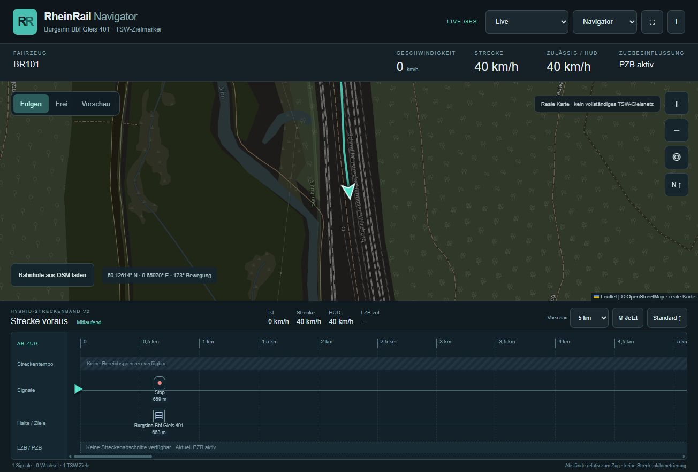

# RheinRail TrainOS

**Version 1.2.0 · ICE 1, ICE 3 und ICE T**

[ZIP herunterladen](https://github.com/RoThorn2711/RheinRail-TrainOS/releases/latest) · [Änderungen in v1.2.0](docs/releases/v1.2.0.md) · [Alle Releases](https://github.com/RoThorn2711/RheinRail-TrainOS/releases)

Ein zweiter Führerstand für **Train Sim World 7**: Fahrzeuganzeigen im Browser auf PC und Tablet, dazu der RheinRail Navigator mit GPS-Karte und grafischem Streckenband. Der lokale Adapter liest die TSW HTTP API. Es werden keine Befehle an das Spiel gesendet.

Unabhängiges, experimentelles Fanprojekt. Keine offizielle Anwendung von Dovetail Games, Deutsche Bahn oder einem Fahrzeughersteller. Die Anzeigen ersetzen keine realen Führerstandssysteme.

## Neu in v1.2.0

- **ICE 1:** zwei getrennte Displays, Tacho bis 400 km/h, LZB und Zug-/Bremskraft in kN.
- **ICE 3:** eigene Tachoskalierung bis 400 km/h und beidseitige Prozentanzeige, ohne Türsymbole.
- **ICE T:** Tacho bis 240 km/h, Prozentanzeige, GNT, LZB/PZB und Sifa; ohne die nicht bedienbaren unteren Menüreiter.
- **Demo und Live:** gemeinsame API-Abfrage, Fahrzeugerkennung, getrennte Caches und Komponenten-Diagnosen.
- Die numerische LZB-Zielentfernung bleibt auch oberhalb von 4.000 m vollständig sichtbar, zum Beispiel **12.800 m**. Nur der Balken endet an seiner Skala.
- Ausgeschaltete Demo-LZB blendet bei ICE 3 und ICE T auch B und die Beschriftung aus. Live wird die Bereitschaft getrennt behandelt.

Die neuen ICE-Ansichten wurden vom Projektinhaber im Spiel ausprobiert und als funktionsfähig bestätigt. Nicht jeder Zustand und jede Variante ist vollständig geprüft; fehlende Werte bleiben leer.

## Anzeigen

| Reiter | Darstellung | Datenquelle |
| --- | --- | --- |
| MFD digital | BR 101 Expert ETCS, Tacho, Kraft und Leuchtmelder | Demo / Live |
| MFA analog | BR 101 Expert ohne ETCS, Rundinstrumente und Leuchtmelder | Demo / Live |
| 145 Expert | Tacho bis 160 km/h, Kraftinstrument und Meldertafel | Demo / vorläufiges Live-Profil |
| ICE 1 | Zwei Displays, 400 km/h, LZB und Kraft in kN | Demo / Live |
| ICE 3 | Zwei Displays, 400 km/h, Fahren und Bremsen in % | Demo / Live |
| ICE T | Zwei Displays, 240 km/h, Prozentanzeige und GNT | Demo / Live |
| Navigator | OSM-Karte, TSW-Position und relative Streckenereignisse | Aufnahme / Live |

Instrumentengrafiken sind Nachzeichnungen. Zugdateneingaben und Fahrzeugbedienung sind nicht implementiert.

### Neue ICE-Ansichten

Die Vektorbilder zeigen die Weboberfläche mit simulierten Werten.

**ICE 1**

**ICE 3**

**ICE T**

### BR 101 und Navigator

Kartengrundlage: © [OpenStreetMap-Mitwirkende](https://www.openstreetmap.org/copyright), ODbL. Die reale Karte kann vom Spiel abweichen. Marken- und Projekthinweise: [RIGHTS.md](RIGHTS.md), [THIRD_PARTY_NOTICES.md](THIRD_PARTY_NOTICES.md).

## Installation und Update

Voraussetzungen: **Node.js ab Version 22**, moderner Browser und für Live TSW 7 auf einem Windows-PC. Zusätzliche npm-Pakete müssen nicht installiert werden.

1. ZIP aus den [Releases](https://github.com/RoThorn2711/RheinRail-TrainOS/releases/latest) herunterladen und entpacken.
2. Beim Update die bisherige TrainOS-Serverinstanz schließen und die neue Version in einen eigenen Ordner entpacken.
3. Für den PC `Start.cmd` öffnen und [http://localhost:8787](http://localhost:8787) aufrufen.
4. Für Tablets im selben vertrauenswürdigen Netzwerk `Start-Tablet.cmd` verwenden. Auf dem Tablet die vom Server angezeigte PC-Adresse statt `localhost` öffnen.
5. Nach einem Update die Browserseite mit **Strg+F5** neu laden.

Alternativ: `npm start`. LAN-Betrieb: `node server.mjs --lan`. Beenden mit **Strg+C** im Startfenster. Nur eine Serverinstanz pro Port starten.

| Direktansicht | Adresse auf dem Spiel-PC |
| --- | --- |
| BR 101 MFD | `http://localhost:8787/?display=mfd` |
| BR 101 MFA | `http://localhost:8787/?display=mfa` |
| BR 145 | `http://localhost:8787/?display=br145` |
| ICE 1 | `http://localhost:8787/?display=ice1` |
| ICE 3 | `http://localhost:8787/?display=ice3` |
| ICE T | `http://localhost:8787/?display=icet` |
| Navigator | `http://localhost:8787/?display=navi` |

Im LAN-Modus ist die Anzeige für erreichbare Geräte ohne Anmeldung verfügbar. Nur im vertrauenswürdigen privaten Netz verwenden; keine Router-Portfreigabe einrichten. TrainOS ändert keine Firewall-Regeln automatisch.

## TSW HTTP API

1. In den Steam-Eigenschaften von TSW 7 die Startoption **`-HTTPAPI`** ergänzen und das Spiel neu starten.
2. Fahrzeug laden und im Führerstand Platz nehmen.
3. Die vom Spiel erzeugte `CommAPIKey.txt` muss unter `Documents/My Games/TrainSimWorld7/Saved/Config/` im Benutzerprofil liegen.
4. In TrainOS **TSW Live – nur lesen** wählen.

Der Adapter liest den Schlüssel lokal und sendet ihn nur im `DTGCommKey`-Header an `127.0.0.1:31270`. Ein abweichender Dateipfad kann über `TSW_KEY_FILE` gesetzt werden. **Schlüsseldatei und private Rohdiagnosen niemals ins Repository kopieren.** Andere Launcher und künftige API-Versionen sind nicht pauschal verifiziert.

## Fahrzeugerkennung und Live-Daten

| Gemeldete Fahrzeugfamilie | Instrumentenprofil |
| --- | --- |
| `RVM_CRG_DB_BR101_ETCS_C` | BR 101 MFD |
| `RVM_CRG_DB_BR101_C` | BR 101 MFA |
| Baureihe 145, einschließlich passender NV-Klassennamen | 145 Expert |
| ICE 1 / BR 401 | ICE 1 |
| ICE 3 / BR 403 oder 406 | ICE 3 |
| ICE T / BR 411 oder 415 | ICE T |

Die Erkennung unterscheidet Fahrzeugfamilien und garantiert nicht jede Variante. Bei erkanntem Fahrzeugwechsel aktiviert TrainOS die passende Ansicht. Falsche Profilanfragen erhalten keine fremden Instrumentendaten. Daten älter als fünf Sekunden werden ausgeblendet. Ein Verbindungsverlust wechselt nicht automatisch zur Demo.

Die BR-101-Kraftquelle zeigt positive Zugkraft pro Fahrmotor und negative elektrische Bremskraft gesamt. Beim ICE 1 ist der genaue Skalenbezug des aggregierten Kraftwerts weiter zu vergleichen. ICE 3 und ICE T übernehmen nur ausdrücklich als Prozent benannte Messwerte; kN oder Hebelstellungen werden nicht als Prozent umgedeutet. Die 145-Zuordnungen bleiben vorläufig.

Beim ICE T werden **GNT eingeschaltet**, **GNT bereit** und **GNT-Überwachung aktiv** getrennt gelesen. Direkte GNT-Leuchtmelder haben Vorrang; andernfalls verwendet die blaue Anzeige vorläufig den Einschaltzustand. Nicht jeder Übergang und Störzustand ist geprüft.

Fehlende oder abweichende Werte: Unter **Einstellungen** die jeweilige Komponenten-Diagnose herunterladen. Sie enthält ausgewählte Messpfade, Werte und Fahrzeugklasse, keinen API-Schlüssel oder VehicleID. Die Rohdatei bleibt außerhalb des Projektpakets.

Details: [API](docs/API.md) · [ICE 1](docs/ice1-demo.md) · [ICE 3](docs/ice3.md) · [ICE T](docs/icet.md).

## Navigator und Streckenband

Der Navigator verbindet eine reale OpenStreetMap-Karte mit TSW-GPS-Daten. Die Spur enthält gemessene Zugpositionen, kein vollständiges TSW-Gleisnetz. Die Fahrtrichtung entsteht aus Bewegung; Streckenname und Kilometrierung werden nicht geschätzt.

Das Streckenband zeigt relative Signalabstände, Geschwindigkeitswechsel und Zielmarker. Scrollen und Ziehen pausieren die Nachführung; **Jetzt** setzt sie zurück. Geschwindigkeitsintervalle entstehen nur zwischen gemeldeten Grenzen. Streckengeschwindigkeit, HUD-Vorgabe und LZB-Vorgabe bleiben getrennte Werte. Eine vollständige EBuLa ist nicht implementiert.

Kartenkacheln und optionale Bahnhofsdaten benötigen Internet. Externe Dienste können ausfallen. Kartenrotation und importierbare Streckenprofile sind nicht implementiert.

## Demo und Tests

Ohne Spiel **Demo** wählen. Unter Einstellungen lassen sich Geschwindigkeit, Kraft beziehungsweise Prozentwert, Sifa, PZB und LZB verändern. Beim ICE T ist GNT separat schaltbar. Der Navigator besitzt eine gekennzeichnete anonymisierte Aufnahme.

`npm test` führt **60 Node-Tests** ohne Spiel, Schlüsseldatei oder zusätzliche Pakete aus. Sie prüfen Einheiten, bekannte Komponentenpfade, fehlende und veraltete Werte, Fahrzeugwechsel, Profilfreigaben, Melder, ICE-Skalen und Navigator-Daten. Automatisierte Prüfungen ersetzen keinen vollständigen Fahr-, Geräte- oder Langzeittest.

## Projektstruktur

| Pfad | Inhalt |
| --- | --- |
| `dist/profiles/` | Instrumente und ICE-Displays |
| `dist/app.js`, `dist/sources.js` | Oberfläche, Demo und Live-Normalisierung |
| `telemetry.mjs`, `telemetry-read.mjs` | Authentifizierter API-Leser und gemeinsame Abfragen |
| `ice*-*.mjs`, `icet-mappings.mjs` | ICE-Messpfade, Melder und Diagnose |
| `server.mjs` | Webserver und getrennte Profil-Caches |
| `navigation.mjs`, `dist/navi.*` | Navigator und Streckenband |
| `test/fixtures/`, `*.test.mjs` | Minimierte Testaufnahmen und Tests |
| `docs/` | Datenregeln, Ansichten und Release-Hinweise |

## Lizenzstatus

Für projektspezifischen Code ist noch **keine allgemeine Open-Source-Lizenz erteilt**. Die öffentliche Sichtbarkeit auf GitHub begründet keine freie Lizenz. Leaflet behält seine BSD-2-Clause-Lizenz; OSM-Inhalte unterliegen ihren jeweiligen Bedingungen. Siehe [RIGHTS.md](RIGHTS.md) und [THIRD_PARTY_NOTICES.md](THIRD_PARTY_NOTICES.md).
